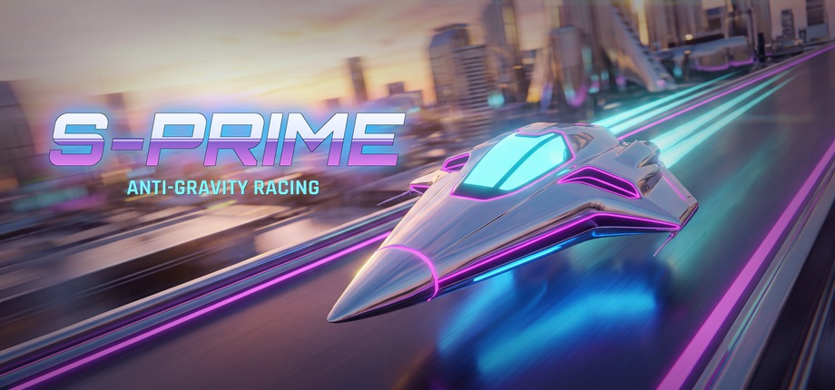
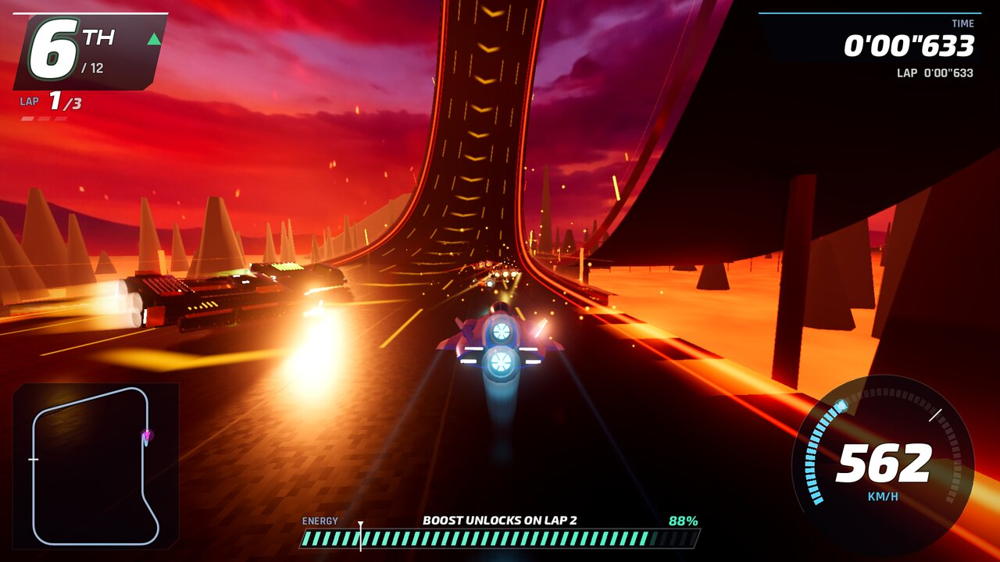
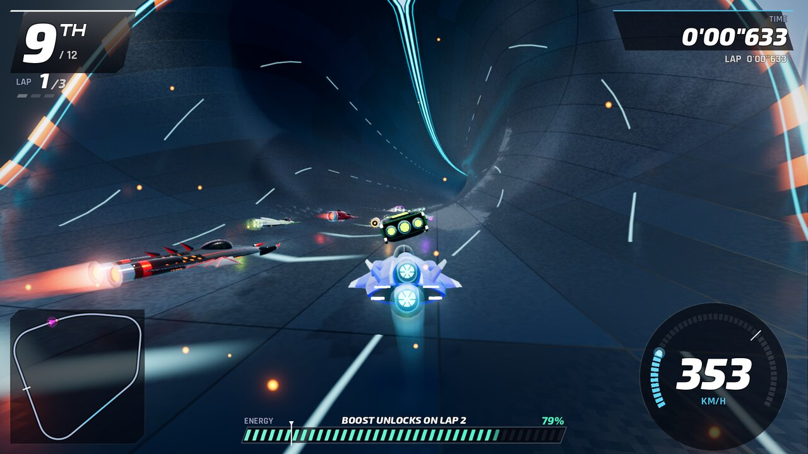
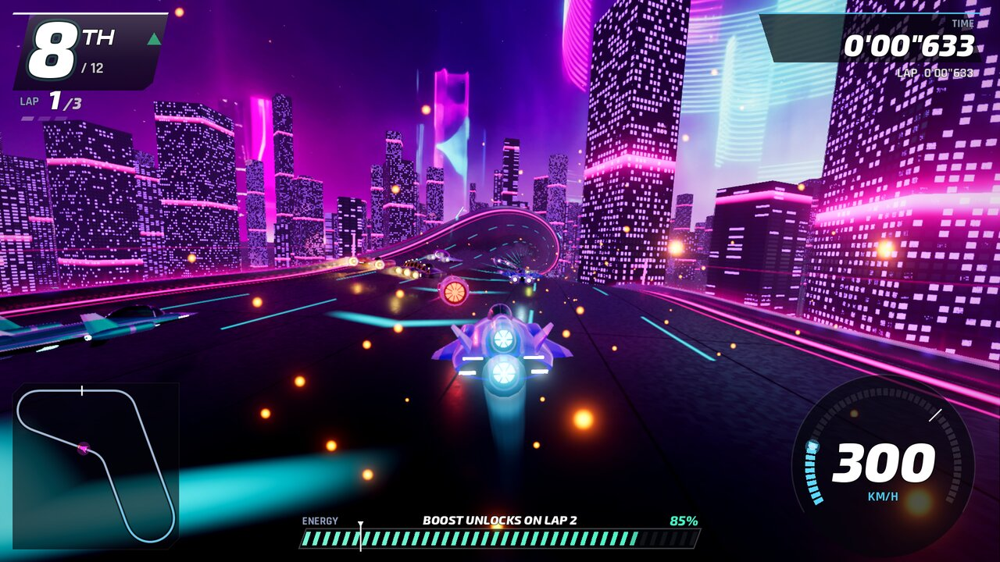
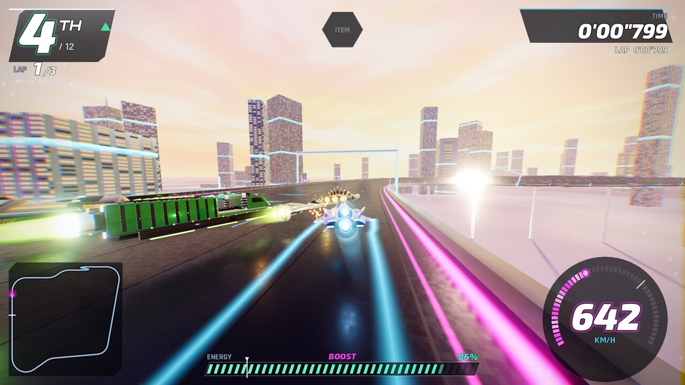

# S-PRIME — Anti-Gravity Grand Prix

Hyper-speed anti-gravity racing: 16 machines, 12 tracks with loops, pipes, cylinders and corkscrews,
1,500 km/h boosts and an optional power-up mode. This page is for **downloading the game**. The source code is private.

## Download for Android

**Scan the QR code with your phone's camera**, or tap
**[Download S-PRIME.apk](https://github.com/chthonik/S-PRIME/releases/latest/download/S-PRIME.apk)** on the phone.
The link always points at the newest version. There's also a [printable QR card](media/S-PRIME_QR_card.png).

1. Chrome may warn that *this type of file can harm your device*. Tap **Download anyway**.
2. Open the downloaded **S-PRIME.apk**. When Android asks, allow **Install unknown apps** for Chrome (or your Files app).
3. If Google Play Protect says it doesn't recognise the developer, tap **More details → Install anyway**.
4. Launch **S-PRIME** and rotate the phone to landscape.

**Requirements:** a 64-bit Android phone or tablet with Android 7.0 or newer and Vulkan graphics (most phones from 2018 on).
The download is about 92 MB.

**Updating:** download and install the new APK over the old one. Your progress is kept.

## Controls on a phone

| | |
|---|---|
| **Steer** | Put your left thumb anywhere in the lower-left and drag. Drag up or down to tilt the nose on jumps. |
| **Accelerate** | Automatic. You can turn it off in Options → Gameplay → Touch screen, which adds an ACCEL button. |
| **BOOST · BRAKE · SPIN · ITEM** | Buttons on the right. ITEM only appears in power-up races. |
| **◀ SLIDE / SLIDE ▶** | Hold to drift through corners. Double-tap to side-attack a rival. |
| **II · CAM** | Pause · change camera. The Android back button or gesture also pauses. |

A Bluetooth Xbox controller works too. The touch buttons fade out while you're using it.

## Screenshots

 
 

---
© 2026 S-PRIME Team. All rights reserved. Made with the Godot Engine.
